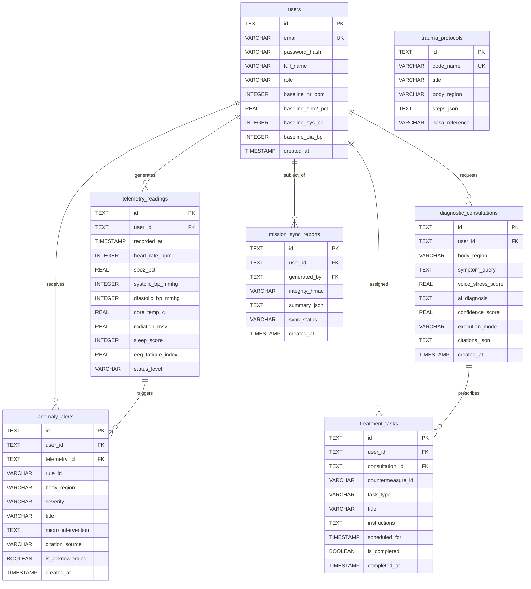

# Database Schema & Data Contracts: AstroHealth AI (V2.1)

## 1. Entity-Relationship Diagram (Mermaid.js)



## 2. Allowlisted Countermeasure Catalog (`backend/data/countermeasure_catalog.json`)
Tasks are materialized exclusively from this catalog using chunk-scoped `countermeasure_id` lookups:

```json
{
  "CM_LBNP_01": {
    "countermeasure_id": "CM_LBNP_01",
    "task_type": "EXERCISE",
    "title": "Lower Body Negative Pressure (LBNP) Countermeasure Session",
    "instructions": "Perform LBNP session at -20 to -25 mmHg to sequester lower-extremity fluid and attenuate cephalad venous congestion per NASA HRP SANS protocol.",
    "scheduled_offset_hours": 1
  },
  "CM_LOW_SODIUM_02": {
    "countermeasure_id": "CM_LOW_SODIUM_02",
    "task_type": "NUTRITION",
    "title": "Low-Sodium Ration & One-Carbon Folate/B-Vitamin Support",
    "instructions": "Select low-sodium ration pack (<2000 mg/day target) and log standard crew B-complex nutritional supplement.",
    "scheduled_offset_hours": 2
  },
  "CM_SSLA_BLUE_03": {
    "countermeasure_id": "CM_SSLA_BLUE_03",
    "task_type": "HABITAT_ADJUSTMENT",
    "title": "SSLA 460nm Blue-Enriched Circadian Light Alignment",
    "instructions": "Set habitat Solid-State Lighting Assembly (SSLA) to high-melanopic 460nm spectrum for 30 minutes during wake phase; switch to warm red-depleted mode 90 minutes pre-sleep.",
    "scheduled_offset_hours": 0
  },
  "CM_MELATONIN_04": {
    "countermeasure_id": "CM_MELATONIN_04",
    "task_type": "MEDICATION",
    "title": "Pre-Sleep Circadian Phase Alignment Protocol",
    "instructions": "Follow Flight Surgeon pre-approved circadian sleep hygiene protocol 30 minutes prior to scheduled sleep window; eliminate caffeine 8 hours before sleep.",
    "scheduled_offset_hours": 4
  },
  "CM_SHIELD_SHELTER_05": {
    "countermeasure_id": "CM_SHIELD_SHELTER_05",
    "task_type": "HABITAT_ADJUSTMENT",
    "title": "Relocate to High-Mass Polyethylene Storm Shelter Zone",
    "instructions": "Remain inside shielded storm shelter station until personal dosimeter readings return below 0.5 mSv/day.",
    "scheduled_offset_hours": 0
  },
  "CM_ANTIOXIDANT_06": {
    "countermeasure_id": "CM_ANTIOXIDANT_06",
    "task_type": "NUTRITION",
    "title": "Antioxidant-Rich Hydration & Carotenoid Ration",
    "instructions": "Consume 1500 mL electrolyte hydration solution with antioxidant-fortified spaceflight ration pack.",
    "scheduled_offset_hours": 1
  },
  "CM_CARDIO_PACED_BREATH_07": {
    "countermeasure_id": "CM_CARDIO_PACED_BREATH_07",
    "task_type": "EXERCISE",
    "title": "Autonomic Paced-Breathing & Restorative Hydration Protocol",
    "instructions": "Suspend high-load resistive exercise for 4 hours, perform 10 minutes of 6-breaths/min vagal paced breathing, and consume 500 mL oral electrolyte solution.",
    "scheduled_offset_hours": 0
  }
}
```